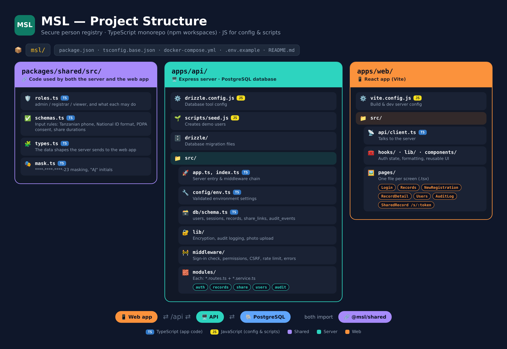

# MSL — Secure person registry

Mobile-first registry for recording people (photo, phone, National ID) with consent,
role-based access, an append-only audit log, and expiring read-only share links.

**Stack:** TypeScript everywhere for application code; plain JavaScript (with `// @ts-check`)
for tool config and scripts.

| Layer    | Tech |
|----------|------|
| API      | Node 20+, Express 5, Drizzle ORM, PostgreSQL, Zod |
| Web      | React 19, React Router 7, Vite |
| Shared   | Zod schemas, roles/permissions, DTO types — used by both API and web |

## Project structure



```
msl/
├── package.json                 # npm workspaces + root scripts
├── tsconfig.base.json           # shared strict TS settings
├── docker-compose.yml           # local Postgres
├── railway.json                 # Railway build / deploy settings
├── .env.example                 # copy to .env
│
├── packages/
│   └── shared/                  # @msl/shared — single source of truth for both sides
│       └── src/
│           ├── roles.ts         # admin / registrar / viewer + permission matrix, can()
│           ├── schemas.ts       # Zod: login, registration (TZ phone, NIDA format, PDPA consent), share TTLs, queries
│           ├── types.ts         # DTOs: RecordDTO, UserDTO, AuditEventDTO, SharedRecordDTO, Paginated<T>
│           ├── mask.ts          # maskNationalId(), initials()
│           └── index.ts
│
├── apps/
│   ├── api/                     # @msl/api — Express REST API
│   │   ├── drizzle.config.js    # JS config
│   │   ├── vitest.config.js     # JS config
│   │   ├── drizzle/             # generated SQL migrations
│   │   ├── scripts/seed.js      # JS script: demo users + TOTP enrolment URLs
│   │   ├── scripts/migrate.js   # JS script: applies migrations (Railway pre-deploy)
│   │   ├── test/                # vitest unit tests
│   │   └── src/
│   │       ├── index.ts         # server entry
│   │       ├── app.ts           # middleware chain + route mounting
│   │       ├── config/env.ts    # validated environment (fails fast)
│   │       ├── db/
│   │       │   ├── schema.ts    # users, sessions, records, share_links, audit_events
│   │       │   └── client.ts
│   │       ├── lib/
│   │       │   ├── crypto.ts    # AES-256-GCM, HMAC, scrypt passwords, tokens
│   │       │   ├── audit.ts     # audit() writer
│   │       │   ├── upload.ts    # 5 MB limit, checks real image bytes, random names
│   │       │   ├── storage.ts   # photo storage: Cloudflare R2 (prod) or local disk (dev)
│   │       │   └── …            # keys, http-error, mask-ip
│   │       ├── middleware/
│   │       │   ├── auth.ts      # session loader, requireAuth, requirePermission
│   │       │   ├── csrf.ts      # per-session CSRF token check
│   │       │   ├── rate-limit.ts
│   │       │   └── error.ts
│   │       ├── modules/         # one folder per feature: *.routes.ts + *.service.ts
│   │       │   ├── auth/        # login (password, optional TOTP), lockout after 5 fails, logout
│   │       │   ├── records/     # list/search, create, reveal ID, verify, photo, CSV export, history
│   │       │   ├── share/       # create link (hashed token) + public read-only endpoint
│   │       │   ├── users/       # list, invite, change role, unlock
│   │       │   └── audit/       # filtered, paginated audit log
│   │       └── types/express.d.ts
│   │
│   └── web/                     # @msl/web — React SPA
│       ├── vite.config.js       # JS config (proxies /api in dev)
│       ├── index.html
│       └── src/
│           ├── main.tsx, App.tsx         # routes
│           ├── api/client.ts             # typed fetch client, attaches CSRF header
│           ├── hooks/                    # useAuth (session + can()), useAsync
│           ├── lib/                      # date/phone formatting, audit event labels
│           ├── components/               # AppHeader, AppLayout, Avatar, Badge, Chip, Pagination, RequireAuth
│           ├── pages/
│           │   ├── LoginPage.tsx         # email + password (+ 2FA code when enabled)
│           │   ├── RecordsPage.tsx       # search, filters, pagination, New / Export
│           │   ├── NewRegistrationPage.tsx
│           │   ├── RecordDetailPage.tsx  # reveal ID, share link, activity history
│           │   ├── UsersPage.tsx         # users and roles
│           │   ├── AuditLogPage.tsx      # grouped by day
│           │   └── SharedRecordPage.tsx  # public /s/:token view
│           └── styles/global.css
```

### How the shared package is consumed
`@msl/shared` exports a `source` condition pointing at its TypeScript, so the API (via
`tsx --conditions=source`), Vite and `tsc` all read `src/` directly in development — no
rebuild loop. `npm run build` emits `packages/shared/dist` for production Node.

## Security model

- **National ID** is encrypted with AES-256-GCM; an HMAC enables duplicate detection without
  decrypting. Only the last 2 digits are stored in clear for masking. The full value is
  returned only by `POST /records/:id/reveal-id` (admin only, `Cache-Control: no-store`) and
  every reveal is audited.
- **Sign-in** is email + password (scrypt). 5 failures lock the account; the error never says
  whether the email or the password was wrong. **2FA is built but off**: set `REQUIRE_2FA=true`
  to require an authenticator code for everyone (users then need a TOTP secret, see below).
- **Sessions:** random token in an `HttpOnly; SameSite=Strict` cookie (`Secure` in production);
  only its SHA-256 is stored. Every non-GET request must carry the session's `X-CSRF-Token`.
- **Share links:** 1 h / 24 h / 7 d; only the token hash is stored; the public endpoint returns
  masked data, is rate-limited, `no-store` and `noindex`; every view is audited.
- **Audit log:** append-only; IPs stored masked (`196.41.xx.xx`).
- **PDPA consent** is mandatory on registration and its timestamp is stored.

## Getting started

```bash
cp .env.example .env              # then fill ID_ENCRYPTION_KEY and ID_HASH_KEY (command in the file)
docker compose up -d db
npm install
npm run db:migrate
npm run db:seed                   # creates the demo users
npm run dev                       # API :4000, web :5173
```

Demo password for seeded users: `ChangeMe123!`.

To try 2FA: set `REQUIRE_2FA=true`, then seed with `SEED_2FA=true npm run db:seed`. That
prints `otpauth://` URLs to add to an authenticator app for James, Sarah and Halima.

## Deploying to Railway + Cloudflare R2

One Railway service runs everything: the API also serves the built web app, so both
share one domain (needed for the `SameSite=Strict` session cookie). Photos live in a
**private** Cloudflare R2 bucket and are only ever streamed through the API after the
permission check, never via a public bucket URL.

**1. Cloudflare R2**
1. Cloudflare dashboard → **R2** → *Create bucket*, e.g. `msl-photos`. Leave public access **off**.
2. R2 → *Manage R2 API tokens* → *Create API token* with **Object Read & Write**, scoped to that bucket.
3. Note the **Account ID**, **Access Key ID** and **Secret Access Key**.

**2. Railway**
1. *New project* → *Deploy from GitHub repo* → this repo. `railway.json` sets the build,
   start command and health check. Database tables are created/updated automatically
   when the app starts, so no separate migration step is needed.
2. *+ New* → *Database* → **PostgreSQL**.
3. On the app service → **Variables**:

   | Variable | Value |
   |---|---|
   | `DATABASE_URL` | `${{Postgres.DATABASE_URL}}` |
   | `NODE_ENV` | `production` |
   | `ID_ENCRYPTION_KEY`, `ID_HASH_KEY` | two different keys (command in `.env.example`); **back them up**, since losing `ID_ENCRYPTION_KEY` makes stored IDs unreadable |
   | `R2_ACCOUNT_ID`, `R2_ACCESS_KEY_ID`, `R2_SECRET_ACCESS_KEY`, `R2_BUCKET` | from step 1 |
   | `WEB_ORIGIN` | only if you use a custom domain (otherwise the Railway domain is used) |

4. *Settings* → *Networking* → **Generate Domain**.
5. **Registrars:** in **Users & roles → Add user**, type the person's full name; a username
   (e.g. `paul.lubinza`) and password are suggested. Email is optional. The sign-in details
   are shown once with copy buttons; hand them over privately. Each registration saves the
   registrar's name as *Msajili*. Use **Reset password** if someone forgets theirs.
6. **First admin:** add `ADMIN_EMAIL` and `ADMIN_PASSWORD` (10+ characters) to the
   variables and redeploy. On startup, while the database has no users, the app creates
   that admin. Sign in, change the password under **Account**, then delete
   `ADMIN_PASSWORD` from Railway. Add everyone else from **Users → + Invite** with a
   temporary password they change under Account.

In production the app refuses to start if any R2 variable is missing, so photos can't
silently land on Railway's temporary disk.

## Scripts

| Command | What it does |
|---|---|
| `npm run dev` | API (watch) + Vite dev server |
| `npm start` | production server (API + built web app) |
| `npm run typecheck` | `tsc --noEmit` in every workspace |
| `npm test` | Vitest in shared + api |
| `npm run build` | shared → dist, api → dist, web → dist |
| `npm run db:generate -w @msl/api` | new migration after editing `schema.ts` |

## Not built yet
- Invite by email (today the admin sets a temporary password and passes it on) and a
  forced password change on first sign-in. TOTP enrolment, for when 2FA is switched on.
- Registrar / date filters in the records list (chips are placeholders); user filter in the audit log
- Record edit form in the web UI (API `PATCH /records/:id` exists)
- Redis-backed rate limiting for multi-instance deployments
